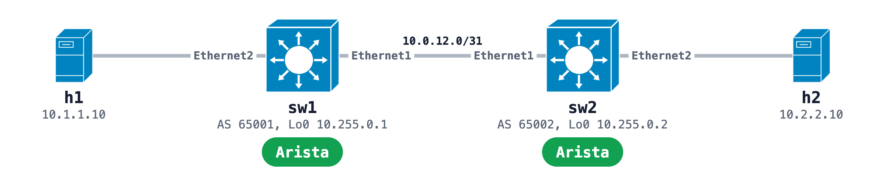

# Arista cEOS eBGP lab: two switches and two hosts

Two cEOS switches with eBGP between them and a Linux host behind each. The startup configs in `configs/` set everything at deploy, so the hosts reach each other with no typing.



## Run it

```bash
sudo containerlab deploy -t two-switches.clab.yml
docker exec clab-arista-two-sw1 Cli -c 'show ip bgp summary'
docker exec clab-arista-two-h1 ping -c 3 10.2.2.10
```

BGP reads `Estab` about 7 seconds after the deploy returns. SSH in as `admin` with password `admin`. You bring the cEOS image yourself: the [Arista README](../README.md) has where to get it and what to know about it.

## Build it from one prompt

[The prompt](https://github.com/netpilot-labs/example-prompts/blob/main/routing/arista-ceos-ebgp-two-switches.md) builds the same lab in [NetPilot](https://www.netpilot.io) and proves the hosts reach each other.

## Tutorial

[Run Arista cEOS in containerlab](https://www.netpilot.io/blog/arista-ceos-containerlab)
