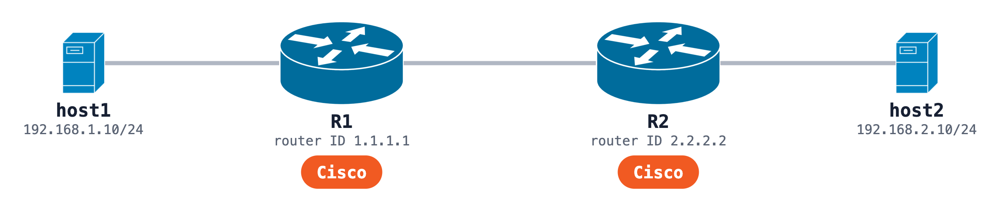

# CCNA OSPF lab on real Cisco IOS, with one stray MTU

The classic two-router CCNA OSPF lab, run on real Cisco IOS (Cisco IOL 17.12.1) instead of a simulator. One detail is planted for you to find: R2's link to R1 runs at IP MTU 1400 while R1 stays at the default 1500.



Watch the run: [Packet Tracer vs Real Cisco IOS: Your CCNA Lab Online, No Install](https://www.youtube.com/watch?v=OgvgcCUHu8g). Read it with every output: [the same CCNA lab on real Cisco IOS](https://www.netpilot.io/blog/network-simulator-online-free#the-same-ccna-lab-on-real-cisco-ios).

## The lab

| Node | Interface | Address |
|---|---|---|
| R1 | Ethernet0/1 (to R2) | 10.0.12.1/30 |
| R1 | Ethernet0/2 (LAN1) | 192.168.1.1/24 |
| R2 | Ethernet0/1 (to R1) | 10.0.12.2/30, `ip mtu 1400` |
| R2 | Ethernet0/2 (LAN2) | 192.168.2.1/24 |
| host1 | eth1 | 192.168.1.10/24 |
| host2 | eth1 | 192.168.2.10/24 |

OSPF process 1, area 0, router IDs 1.1.1.1 and 2.2.2.2, the LAN interfaces passive, the R1 to R2 link point-to-point.

## The exercise

1. Deploy it (see the [repository README](../README.md)) and run `show ip ospf neighbor` on both routers.
2. Ping host2 from host1: `sudo docker exec clab-ccna-ospf-mtu-host1 ping -c 5 192.168.2.10`.
3. Find why the neighbors never reach FULL, on the CLI.
4. Fix it the clean way and prove it: both neighbors FULL, `O 192.168.2.0/24` on R1, the ping at 0% loss.

<details>
<summary>What we saw, and the fix</summary>

R2 sat in EXSTART and R1 in EXCHANGE, and the ping lost 5 of 5. `debug ip ospf adj` on R2 printed `Nbr 1.1.1.1 has larger interface MTU`, retransmitting about every 5 seconds. OSPF compares the MTU while two neighbors exchange their databases.

Lowering R1 to 1400 brings the adjacency up, but it moves the good side to the bad value. The clean fix removes the stray setting on R2:

```cisco
R2(config)# interface Ethernet0/1
R2(config-if)# no ip mtu
```

An adjacency that is already FULL does not compare the MTU again, so restart OSPF (`clear ip ospf process` on R1, answer yes) to form it fresh at 1500.

</details>

## Back to Packet Tracer

[`packet-tracer/ccna-ospf-mtu.pkt`](packet-tracer/ccna-ospf-mtu.pkt) is the fixed lab exported for Cisco Packet Tracer 9.0: two 2911 routers, two PCs, 4 devices and 3 links, no `ip mtu`. The router configs are next to it. It was exported from the run, not opened in Packet Tracer during it.

## Build it from one prompt

[The prompt](https://github.com/netpilot-labs/example-prompts/blob/main/troubleshooting/cisco-ios-ospf-mtu-mismatch.md) builds the same lab in [NetPilot](https://www.netpilot.io/cisco-virtual-lab) on real Cisco IOS, finds the MTU on the CLI, fixes it and exports the `.pkt`.
