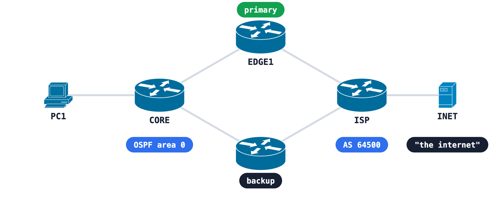

# Network engineer troubleshooting interview lab on real Cisco IOS

A broken branch network for a technical interview: four Cisco IOL routers, two Linux hosts and three faults, easy to hard. The candidate gets one line, "the branch can't reach the internet, fix it and keep traffic on the primary in both directions", and works the router consoles while you watch.

## The lab

| Node | Interface | Address |
|---|---|---|
| PC1 | eth1 | 10.10.10.10/24, gateway 10.10.10.1 |
| CORE | Ethernet0/1 (LAN), 0/2 (to EDGE1), 0/3 (to EDGE2) | 10.10.10.1/24, 10.0.1.1/30, 10.0.2.1/30 |
| EDGE1 | Ethernet0/1 (to CORE), 0/2 (primary circuit) | 10.0.1.2/30, 198.51.100.2/30 |
| EDGE2 | Ethernet0/1 (to CORE), 0/2 (backup circuit) | 10.0.2.2/30, 198.51.100.6/30 |
| ISP | Ethernet0/1, 0/2, 0/3 (to INET) | 198.51.100.1/30, 198.51.100.5/30, 203.0.113.1/24 |
| INET | eth1 | 203.0.113.10/24 |

The branch is AS 65010 with OSPF area 0 on CORE, EDGE1 and EDGE2. Both edges run eBGP to ISP in AS 64500, which sends them a default route. By design EDGE1 is the primary in both directions: a lower OSPF default metric outbound, and BGP metric (MED) 50 against EDGE2's 200 inbound. Documentation and private address space only.

## The interview

1. Deploy it (see the [repository README](../../README.md)). Every fault is in the startup configs, so a redeploy resets it for the next candidate.
2. Give the candidate the brief from [ANSWER-KEY.md](ANSWER-KEY.md) and the lab link. Keep the answer key to yourself.
3. Watch where they start. The symptom: `sudo docker exec clab-branch-tshoot-interview-01-PC1 ping -c 3 203.0.113.10` gets no reply.
4. When they say they're done, check both directions: the ping from PC1, and a traceroute from INET back to 10.10.10.10 that should return through 198.51.100.2.

[ANSWER-KEY.md](ANSWER-KEY.md) holds the brief to read aloud, each fault's symptom, the commands that find it, the fix, partial credit and a scoring guide, as the agent wrote it on the recorded run.

## Build it from one prompt

[The prompt](https://github.com/netpilot-labs/example-prompts/blob/main/troubleshooting/network-engineer-interview-lab.md) builds this lab in [NetPilot](https://www.netpilot.io/cisco-virtual-lab) on real Cisco IOS, plants the three faults, proves each fix and writes the answer key. A second prompt asks the agent what the candidate changed and whether anything is still broken.
