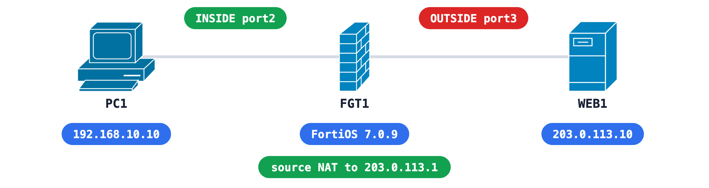

# FortiGate zones, policy and source NAT lab

One FortiGate between an inside zone and an outside zone, a PC inside and a web server outside. The inside reaches the outside through source NAT, nothing gets in from the outside, and a deny policy above the allow blocks ping while web traffic keeps working.



| Node | Interface | Zone | Address |
|---|---|---|---|
| FGT1 | port2 | INSIDE | 192.168.10.1/24 |
| FGT1 | port3 | OUTSIDE | 203.0.113.1/24 |
| PC1 | eth1 | | 192.168.10.10/24, route to 203.0.113.0/24 via FGT1 |
| WEB1 | eth1 | | 203.0.113.10/24, route to 192.168.0.0/16 via FGT1 |

203.0.113.0/24 is a documentation range: nothing here touches the real internet.

| Policy | Name | From, to | Service | Action |
|---|---|---|---|---|
| 2 (first) | INSIDE-BLOCK-PING | INSIDE to OUTSIDE | ALL_ICMP | deny |
| 1 | INSIDE-to-OUTSIDE | INSIDE to OUTSIDE | ALL | accept, NAT on |
| implicit | | anything else, OUTSIDE to INSIDE included | | deny |

## Run it

You need the FortiGate image built with vrnetlab (see the [Fortinet README](..)), then:

```bash
sudo containerlab deploy -t fortigate-zones-policy-nat.clab.yml
```

Wait until `FGT1` reports `healthy` in `sudo containerlab inspect -t fortigate-zones-policy-nat.clab.yml`. Log in with `admin` / `admin`:

```bash
ssh admin@clab-fortigate-zones-policy-nat-FGT1
```

## 1. Read the policy order

```bash
show firewall policy
```

Policy 2 is listed before policy 1. The FortiGate uses the first policy that matches, so ICMP hits the deny before the allow.

## 2. Prove it from the PC

```bash
sudo docker exec clab-fortigate-zones-policy-nat-PC1 ping -c 5 203.0.113.10
sudo docker exec clab-fortigate-zones-policy-nat-PC1 curl -s -o /dev/null -w "%{http_code}\n" http://203.0.113.10
```

The ping fails 0 of 5 and the web request answers `200`. Read each policy's hit counter on FGT1:

```bash
diagnose firewall iprope show 100004 2
diagnose firewall iprope show 100004 1
```

## 3. Watch the NAT

Delete the deny on FGT1 and ping again:

```bash
config firewall policy
    delete 2
end
diagnose sys session filter dst 203.0.113.10
diagnose sys session list
```

With PC1 pinging, the session shows `act=snat 192.168.10.10:<port>->203.0.113.10:8(203.0.113.1:<port>)` and `policy_id=1`: PC1's address is translated to FGT1's outside address. From WEB1, `ping -c 3 192.168.10.10` stays 0 of 3: the implicit deny drops it.

Tested on 2026-11-23 with FortiOS 7.0.9 (`vrnetlab/vr-fortios:7.0.9`). With policy 1 only: PC1 to WEB1 5 of 5, WEB1 to PC1 0 of 3, the session with the NAT address as above, HTTP 200 from PC1. With policy 2 above it: ping 0 of 5 (policy 2 hits 5) and HTTP 200 3 of 3. A full redeploy from these files gave the same result.

The FortiGate VM image runs on a 15-day evaluation licence that starts at first boot, and each fresh deploy starts from the clean image. FortiOS 7.0.x forwards traffic on that licence. Later builds may not.

## Build it from one prompt

On NetPilot the same lab builds from one prompt in the browser, on a real FortiGate with nothing installed on your machine: [the prompt](https://github.com/netpilot-labs/example-prompts/blob/main/security/fortigate-zones-policy-nat.md). Tutorial: [Firewall lab: Palo Alto and FortiGate](https://www.netpilot.io/blog/firewall-lab-palo-alto-fortinet). The recorded run: [FortiGate Lab in Minutes](https://www.youtube.com/watch?v=NTI95FHN6xo).
