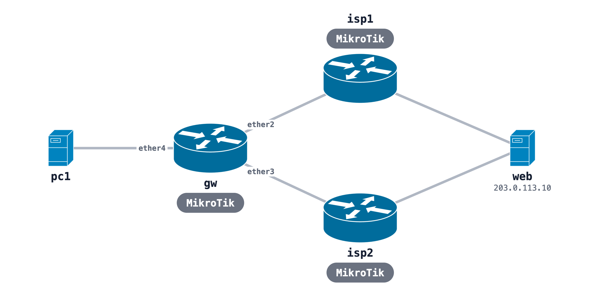

# MikroTik dual WAN PCC load balancing with failover

A RouterOS 7 gateway with uplinks to two ISP routers, PCC load balancing across them, and a failover route for each WAN. Both ISPs reach one web server, and a PC sits on the LAN.



## Run it

```bash
sudo containerlab deploy -t dual-wan-pcc.clab.yml
ssh admin@clab-dual-wan-pcc-gw              # password admin
/ip firewall mangle print stats
/ip route print where routing-table~"to_wan"
```

Traffic from pc1 to 203.0.113.10 splits across both WANs by connection. To test failover, break ISP-1's upstream while the gateway link stays up, then watch pc1's traffic move to ISP-2. The tutorial has the timing. The image, KVM and memory notes are in the [MikroTik README](../README.md).

## Build it from one prompt

[The prompt](https://github.com/netpilot-labs/example-prompts/blob/main/routing/mikrotik-dual-wan-pcc-failover.md) builds the same lab in [NetPilot](https://www.netpilot.io/mikrotik-lab), kills ISP-1 upstream and measures the outage.

## Tutorial

[MikroTik load balancing with PCC](https://www.netpilot.io/blog/mikrotik-load-balancing-pcc)
