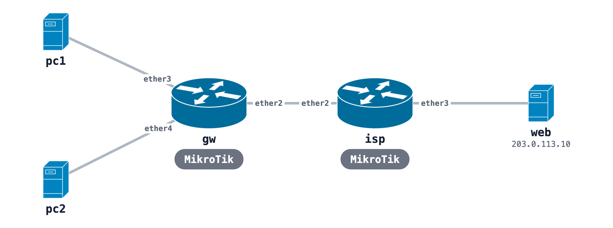

# MikroTik MTCNA practice lab

A RouterOS gateway, an ISP router, a web server and two PCs, for practice with DHCP, bridging, NAT, the firewall, queues and PPPoE. The ISP hands the gateway its WAN address over DHCP. The gateway's startup config `gw.rsc` already applies exercises 1 to 4 (the DHCP client, the LAN bridge and DHCP server, NAT and the firewall), so you can read along. To type them yourself, delete those lines before you deploy.



## Run it

```bash
sudo containerlab deploy -t mtcna-practice.clab.yml
ssh admin@clab-mtcna-practice-gw            # password admin
```

The PCs start with no address. Get a lease and reach the web server:

```bash
docker exec clab-mtcna-practice-pc1 udhcpc -i eth1 -n -q
docker exec clab-mtcna-practice-pc1 ip route add 203.0.113.0/24 via 192.168.88.1
docker exec clab-mtcna-practice-pc1 ping -c2 203.0.113.10
```

The image, KVM and memory notes are in the [MikroTik README](../README.md).

## Build it from one prompt

[The prompt](https://github.com/netpilot-labs/example-prompts/blob/main/routing/mikrotik-routeros-practice-lab.md) builds the same lab in [NetPilot](https://www.netpilot.io/mikrotik-lab) and leaves NAT and the firewall for you.

## Tutorial

[MTCNA practice lab](https://www.netpilot.io/blog/mtcna-practice-lab), with each exercise and its real output.
