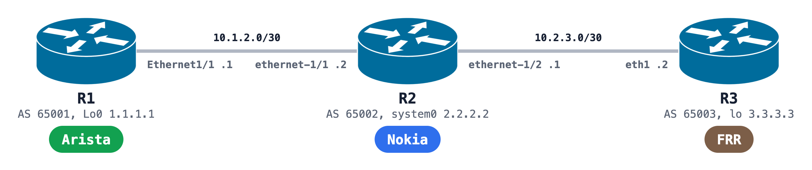

# Multi-vendor eBGP lab: Arista, Nokia and FRR in three autonomous systems

Three routers from three vendors in a chain, each in its own AS, each advertising its loopback into eBGP. Nokia SR Linux in the middle carries the Arista and FRR routes between them.



## Run it

```bash
sudo containerlab deploy -t ebgp-three-as.clab.yml
```

Check it:

```bash
docker exec clab-ebgp-three-as-R1 Cli -c 'show ip bgp summary'
docker exec clab-ebgp-three-as-R2 sr_cli 'show network-instance default protocols bgp neighbor'
docker exec clab-ebgp-three-as-R3 vtysh -c 'show bgp ipv4 unicast summary'
docker exec clab-ebgp-three-as-R1 Cli -p 15 -c 'ping 3.3.3.3 source 1.1.1.1 repeat 5'
```

All three routers load their startup configs at deploy. R3 runs on containerlab's `frr` kind, which needs containerlab 0.83 or later, and boots `configs/R3.conf` as its `frr.conf`. Give the sessions about 30 seconds after the deploy returns: SR Linux is the last to come up. `ssh admin@clab-ebgp-three-as-R3` with password `admin` lands in vtysh.

Two details that stop this lab when it is built by hand. SR Linux eBGP imports and exports nothing until a routing policy allows it, so R2 has an accept-all import policy and an export policy for its loopback and the BGP-learned routes. FRR applies the RFC 8212 default to eBGP, so R3 has a permit-all route-map in both directions. The FRR link to SR Linux runs at MTU 1500 (the `exec` line), to match SR Linux.

SSH to R1 as `admin` with password `admin`, the lab default in `configs/R1.cfg`: change it before you expose the lab. You bring the cEOS image yourself: the [Arista README](../../arista/README.md) has where to get it. SR Linux and FRR are public images. R3's image is the one NetPilot labs run: FRR's official containerlab image for 10.7.1 with tcpdump, iperf3, iptables and nftables added.

## Tested on

Deployed as written here on 2026-11-20 with containerlab 0.83.0: cEOS 4.36.1F, SR Linux 25.10.1 (the `latest` tag that day) and FRR 10.7.1. The deploy returned after 49 seconds, and R3's loopback was in R1's table within 30 seconds of that. Both of R2's sessions read established, R1 and R3 each received the other two loopbacks, and the ping from 1.1.1.1 to 3.3.3.3 got 5 of 5 replies with a TTL of 63. A `containerlab deploy --reconfigure` gave the same result.

The lab first ran in NetPilot on 2026-11-11 with FRR 8.4 in a plain Linux container, configured through vtysh after the deploy. This version moves R3 to the `frr` kind with the same configuration as a startup file.

## Build it from one prompt

[The prompt](https://github.com/netpilot-labs/example-prompts/blob/main/routing/bgp-ebgp-three-as.md#from-claude) builds the same lab in [NetPilot](https://www.netpilot.io) from Claude, ChatGPT or any MCP assistant, and checks every session and the loopback ping.

## Tutorial

[Multi-vendor eBGP from one prompt in Claude](https://www.netpilot.io/blog/netpilot-in-claude#multi-vendor-ebgp-from-one-prompt)
