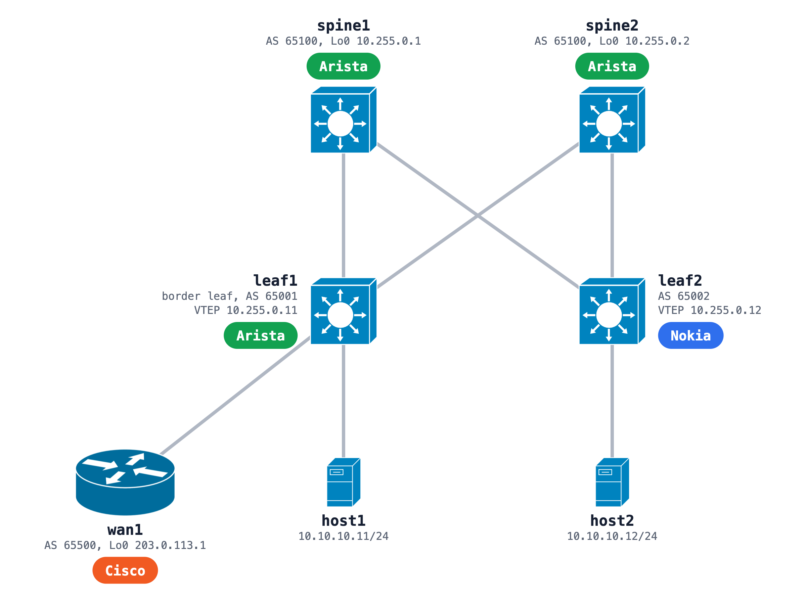

# Multi-vendor EVPN-VXLAN fabric: Arista and Nokia SR Linux leaves with a Cisco WAN edge

A leaf-spine data center fabric across three vendors: two Arista cEOS spines, an Arista cEOS border leaf, a Nokia SR Linux leaf and a Cisco IOL router as the WAN edge. eBGP underlay, BGP EVPN overlay, VLAN 10 stretched over VXLAN between the two leaves, VRF TENANT routed on an L3 VNI, and a default route from the Cisco edge carried into the VRF as an EVPN route. BFD runs on every underlay session.



| Item | Value |
|---|---|
| Underlay links | spine1 to leaf1 10.1.1.0/31, spine1 to leaf2 10.1.1.2/31, spine2 to leaf1 10.1.2.0/31, spine2 to leaf2 10.1.2.2/31 (spine side .0 and .2) |
| Underlay | eBGP, spines AS 65100, leaf1 AS 65001, leaf2 AS 65002, hold timer 9 s, BFD |
| Overlay | BGP EVPN between the leaf and spine loopbacks, the spines as route servers (next hop unchanged) |
| Stretched VLAN | VLAN 10 on VNI 10010, route target 65000:10010, anycast gateway 10.10.10.1 on both leaves |
| Routed VRF | VRF TENANT on L3 VNI 50001, route target 65000:50001 |
| WAN edge | wan1 in AS 65500, eBGP to leaf1 inside VRF TENANT on 172.16.255.0/30, sends a default route |
| BFD | 300 ms × 3 on the Arista side, 1 s × 3 on the Nokia leaf |

## Run it

```bash
sudo containerlab deploy -t evpn-vxlan-fabric.clab.yml
```

All five network nodes load their startup configs at deploy, and the hosts get their addresses from the `exec` lines. The Cisco router takes a little longer to boot than the rest, so give the WAN session a moment.

## Check it

```bash
# underlay and overlay on the Arista border leaf, and the VRF session to the Cisco edge
docker exec clab-evpn-vxlan-fabric-leaf1 Cli -c 'show ip bgp summary'
docker exec clab-evpn-vxlan-fabric-leaf1 Cli -c 'show bgp evpn summary'
docker exec clab-evpn-vxlan-fabric-leaf1 Cli -c 'show ip bgp summary vrf TENANT'
docker exec clab-evpn-vxlan-fabric-leaf1 Cli -c 'show bfd peers'

# the Nokia leaf: its BGP sessions and the default route in VRF TENANT
docker exec clab-evpn-vxlan-fabric-leaf2 sr_cli 'show network-instance default protocols bgp neighbor'
docker exec clab-evpn-vxlan-fabric-leaf2 sr_cli 'show network-instance TENANT route-table ipv4-unicast summary'

# host to host over the stretched VLAN, and each host to the WAN loopback
docker exec clab-evpn-vxlan-fabric-host1 ping -c 5 10.10.10.12
docker exec clab-evpn-vxlan-fabric-host1 ping -c 5 203.0.113.1
docker exec clab-evpn-vxlan-fabric-host2 ping -c 5 203.0.113.1
```

On wan1, `show ip bgp summary` over SSH shows the session to 172.16.255.2.

## The spine test

Start a ping that runs five times a second on a host, freeze the spine that carries the traffic, and read the gap:

```bash
docker exec clab-evpn-vxlan-fabric-host1 ping -D -i 0.2 10.10.10.12
sudo docker pause clab-evpn-vxlan-fabric-spine1
# wait about a minute, then
sudo docker unpause clab-evpn-vxlan-fabric-spine1
```

A frozen spine keeps its links up, so the leaves only notice it when a timer expires: the BGP hold timer without BFD, the BFD detection time with it. After a test the flows can move onto the other spine, so freeze that one on the next run.

Three details that stop this lab when it is built by hand. SR Linux eBGP imports and exports nothing until a routing policy allows it, so leaf2 has an accept-all import policy, an export policy for its loopback on the underlay and accept-all on the EVPN group. The spines carry EVPN routes between two leaves in different autonomous systems, so they keep the next hop unchanged. The two leaves share the anycast gateway MAC 00:00:5e:00:01:01, so a host sees the same gateway on either leaf.

Set your own password where the three Arista configs read `<set-a-password>` before you deploy: a cEOS startup config replaces containerlab's default one, login included. The Nokia and Cisco nodes keep containerlab's default login for their kind. You bring the Arista cEOS and Cisco IOL images yourself: the [Arista](../../arista/README.md) and [Cisco](../../cisco/README.md) READMEs say where to get them. Nokia SR Linux and the network-multitool hosts are public images.

## Tested on

The recorded NetPilot run on 2026-11-13, on containerlab 0.77.0: Arista cEOS 4.36.1F, Nokia SR Linux 25.10.1, Cisco IOL 17.12.1 and network-multitool (the `latest` tag that day).

- All 9 BGP sessions Established on both ends: 4 underlay, 4 EVPN overlay and 1 VRF session from leaf1 to wan1
- host1 to host2 5 of 5 both ways over the stretched VLAN, each host to 203.0.113.1 5 of 5 through the default route
- leaf2 received the default route as an EVPN route in VRF TENANT, pointing at leaf1 on VNI 50001
- Spine test before BFD: spine1 frozen for about 71 s, all 4 flows still 5 of 5, outage 8.52 s (host1 to host2) and 8.31 s (host2 to the WAN), set by the 9 s BGP hold timer
- BFD added live without resetting any BGP session, 8 of 8 BFD peers Up
- Spine test with BFD (spine2, since all traffic had moved onto it): outage 2.90 s on both flows, about 66% shorter. The gap ended 16 ms after the Nokia leaf's BFD expired, so in this lab its 1 s × 3 timers set the floor
- Redeployed from these startup files with BFD saved in: BFD up on all 8 sessions, all 4 host pings 5 of 5

Changes from the run, for portability: the lab is renamed from `dc-evpn-ceos-srl-01` to `evpn-vxlan-fabric`, the fixed management subnet and addresses are dropped (containerlab picks its default), the startup-config paths point at `configs/` (file names kept as the run deployed them), and the lab password in the three Arista configs is replaced by a placeholder. The run deployed the original files: these portability edits were not redeployed as a package.

## Build it from one prompt

[The prompt](https://github.com/netpilot-labs/example-prompts/blob/main/multi-vendor/evpn-vxlan-fabric-design-check.md) states this design in plain words, builds it in [NetPilot](https://www.netpilot.io), checks it on each device's CLI, and runs the spine test before and after BFD.

## Tutorial

[Validate an EVPN VXLAN fabric design before you build it](https://www.netpilot.io/blog/validate-evpn-vxlan-fabric-design) · [watch](https://www.youtube.com/watch?v=IyGWNQsMI28)
