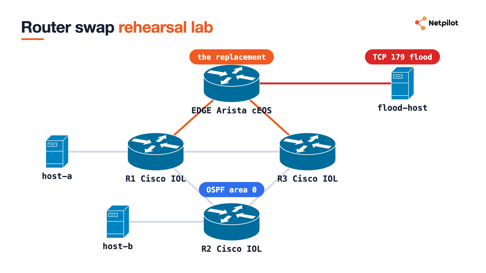

# Router swap flood: a new Juniper router floods a legacy Cisco OSPF core, then an inbound filter contains it

Recreate the FAA ground stop failure class before your own cutover window. Three Cisco IOL routers are the legacy core on OSPF area 0, with a Linux host on two of them. A new Juniper cRPD router joins OSPF, linked to two of the core routers, and sends TCP connection attempts to port 179 on the core's addresses at a rate you set. You measure the OSPF neighbors and the ping loss between the hosts before and during the flood, name the source with counters, contain it on the Cisco side and prove the network recovers with the flood still running.



| Item | Value |
|---|---|
| Core links | R1 to R2 10.0.12.0/30, R2 to R3 10.0.23.0/30, R1 to R3 10.0.13.0/30, point-to-point OSPF |
| New router links | R1 Ethernet1/0 to JNEW eth1 10.0.14.0/30, R3 Ethernet0/3 to JNEW eth2 10.0.34.0/30 |
| Loopbacks | R1 10.255.0.1, R2 10.255.0.2, R3 10.255.0.3, JNEW 10.255.0.4 |
| Host LANs | host-a 10.0.1.10/24 on R1, host-b 10.0.2.10/24 on R2 |
| Routing | OSPF area 0 everywhere, R1's and R2's host LANs passive |
| The flood | `flood.py <rate>` inside JNEW: non-blocking TCP connects to port 179 on the six core addresses, paced to the rate |
| The legacy core | `legacy-core.sh` on the lab VM host: a Cisco router busy answering a flood gets almost no CPU |

## The legacy core

On full-speed images this flood barely registers: an earlier run at the same 250 attempts a second saw 0 % ping loss and every adjacency FULL. Officials describe legacy equipment, so the lab carries the limit with it. `legacy-core.sh` watches each Cisco IOL node and, while a node is answering a flood (TCP RSTs or SYN-ACKs leaving it at 30 a second or more), caps that container to 1 ms of CPU a second through its cgroup. Every 50 seconds it lifts the cap for 3 seconds to test again, and it gives full CPU back once the node answers under 10 a second. A node that is not answering a flood runs at full speed. A fixed CPU cap on the three nodes is not the same condition: in a trial it did not reproduce the break, and OSPF held.

It needs root (or sudo) on the lab VM host, cgroup v2 with Docker's systemd cgroup driver (as on the NetPilot lab VM), and `tc` and `nsenter`. It only touches this lab's Cisco nodes (`LAB=<name> ./legacy-core.sh` for a lab with another name), gives full CPU back when it stops or is killed, and adds tc clsact counters on the Cisco nodes' interfaces, which only count packets. `./legacy-core.sh --off` stops it and gives all three routers full CPU back, the same as `echo "max 100000" | sudo tee /sys/fs/cgroup/system.slice/docker-<container id>.scope/cpu.max` for each Cisco IOL container.

## Run it

```bash
sudo containerlab deploy -t router-swap-flood.clab.yml
sudo docker cp flood.py clab-router-swap-flood-JNEW:/tmp/flood.py
nohup ./legacy-core.sh > legacy-core.log 2>&1 &
```

The routers load their startup configs at deploy and the hosts get their addresses from the `exec` lines. Give OSPF about a minute to reach FULL on all five adjacencies. Start `legacy-core.sh` on the host before the flood. JNEW sets `mtu 1500` on both links: cRPD takes its MTU from the container link, and a mismatch keeps OSPF from reaching FULL with the Cisco routers.

## Measure, flood, trace, contain

```bash
# baseline: 200 pings at 10 a second across the core, and the neighbors on R1, R2 and R3
docker exec clab-router-swap-flood-host-a ping -i 0.1 -c 200 -W 1 10.0.2.10 | tail -3
# on R1, R2 and R3: show ip ospf neighbor

# the flood from the new router, 250 attempts a second, then the same ping again
docker exec -d clab-router-swap-flood-JNEW sh -c 'nohup python3 /tmp/flood.py 250 > /tmp/flood.log 2>&1 &'
docker exec clab-router-swap-flood-JNEW tail -1 /tmp/flood.log
# on R1: show logging | include ADJCHG
```

Trace it with a counting ACL on each Cisco interface that faces JNEW, its first entry scoped to JNEW's link address. On R1 (R3 the same with `DETECT-R3`, `host 10.0.34.2` and Ethernet0/3):

```
ip access-list extended DETECT-R1
 permit tcp host 10.0.14.2 any eq 179
 permit tcp any any eq 179
 permit ip any any
interface Ethernet1/0
 load-interval 30
 ip access-group DETECT-R1 in
```

Then `show ip access-lists DETECT-R1`: the scoped entry counts the flood and the generic one stays at 0. Contain it with `controls/edge-filter-cisco.txt` on R1 and R3 and the backstop `controls/copp-cisco.txt` on all three, and measure the same two things again with the flood running. The routers' CLI can time out while the flood runs: pause it with `docker exec clab-router-swap-flood-JNEW pkill -f flood.py`, apply the controls, then start the flood again. Read the counters with `show ip access-lists EDGE-R1-IN` and `show policy-map control-plane input class CM-TCP179`.

Set your own password where the Juniper config reads `<set-a-password>` before you deploy: a cRPD startup config replaces containerlab's default one, login included. The Cisco nodes keep containerlab's default login. You bring the Cisco IOL and Juniper cRPD images yourself: the [Cisco](../../cisco/README.md) and [Juniper](../../juniper/README.md) READMEs say where to get them. cRPD runs OSPF with no license. The network-multitool hosts are a public image.

## Build it from one prompt

[Router swap flood rehearsal](https://github.com/netpilot-labs/example-prompts/blob/main/change-validation/router-swap-flood-rehearsal.md) builds this lab, applies the legacy-core limit and runs every step above from one plain-English prompt in NetPilot. The run, its numbers and a cutover checklist: [FAA ground stop: the router swap flood, rebuilt in a lab](https://www.netpilot.io/blog/faa-ground-stop-router-swap-lab).

## Tested on

The recorded NetPilot run on 2026-11-16, on a 16 vCPU lab VM with `legacy-core.sh` running: Cisco IOL 17.12.1, Juniper cRPD 23.2R1.13 and network-multitool (the `latest` tag that day). 14 min 10 s from the prompt to the summary.

- Baseline: every OSPF adjacency FULL (R1 3, R2 2, R3 3), host-a to host-b 200 of 200, RTT avg 0.487 ms
- The flood at 250.1 attempts a second from JNEW: 103 of 200 pings, 48.5 % loss, RTT avg about 2,932 ms. R1's adjacency to JNEW went down on its dead timer three times, back FULL after 7 to 24 s each time, and SSH to R1 and R3 timed out
- The trace: the scoped entries matched 2,894 packets from 10.0.14.2 on R1 and 3,010 from 10.0.34.2 on R3, the generic entry 0 on both. About 1 min 20 s from the counting ACL to the named source
- The fix, flood still at 250.1 a second: 200 of 200 pings, RTT 0.452 ms, every adjacency FULL. EDGE-R1-IN denied 8,734 and EDGE-R3-IN 4,364 in the first minute
- CoPP alone, R1's filter lifted for about 15 s: 525 conformed, 354 dropped, OSPF FULL
