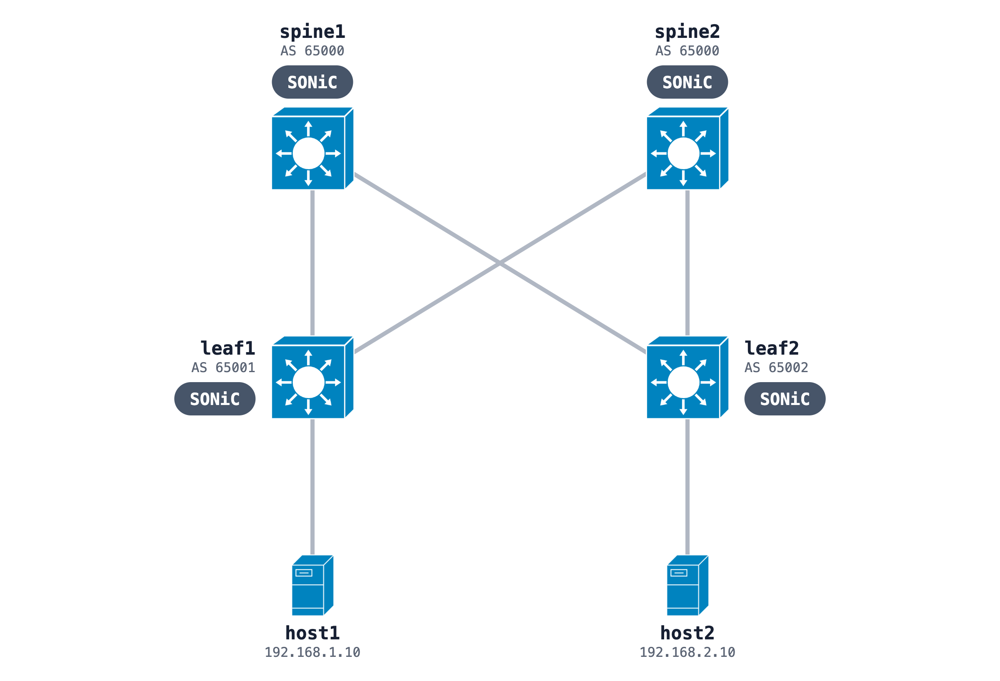

# SONiC leaf-spine with eBGP and ECMP

Two spines, two leaves and two Linux hosts. Each switch configures itself at deploy from its script in `configs/`: interfaces in CONFIG_DB, BGP in FRR. Each leaf learns the other leaf's LAN over two equal-cost paths.



Leaf loopbacks are 10.255.0.11 and 10.255.0.12. Every leaf-to-spine link is a /31.

## Run it

```bash
sudo containerlab deploy -t bgp-leaf-spine.clab.yml
docker exec clab-sonic-bgp-leaf1 vtysh -c 'show bgp summary'
docker exec clab-sonic-bgp-leaf1 ip route show 192.168.2.0/24
docker exec clab-sonic-bgp-host1 ping -c 3 192.168.2.10
```

The route shows two next hops, one through each spine. The fabric was ready about 60 seconds after the deploy began. The image and memory notes are in the [SONiC README](../README.md).

## Build it from one prompt

[The prompt](https://github.com/netpilot-labs/example-prompts/blob/main/data-center/sonic-bgp-leaf-spine-ecmp.md) builds the same fabric in [NetPilot](https://www.netpilot.io/sonic-nos-lab), shows the ECMP routes on both leaves and pings host to host.

## Prove the design

[A second prompt](https://github.com/netpilot-labs/example-prompts/blob/main/poc/design-validation-spine-failure.md) builds the same fabric, shuts spine1 and shows host1 still reaching host2 through spine2.

## Tutorial

[SONiC FRR: configure BGP on a SONiC switch](https://www.netpilot.io/blog/sonic-frr-bgp), with BFD and the failover numbers.
