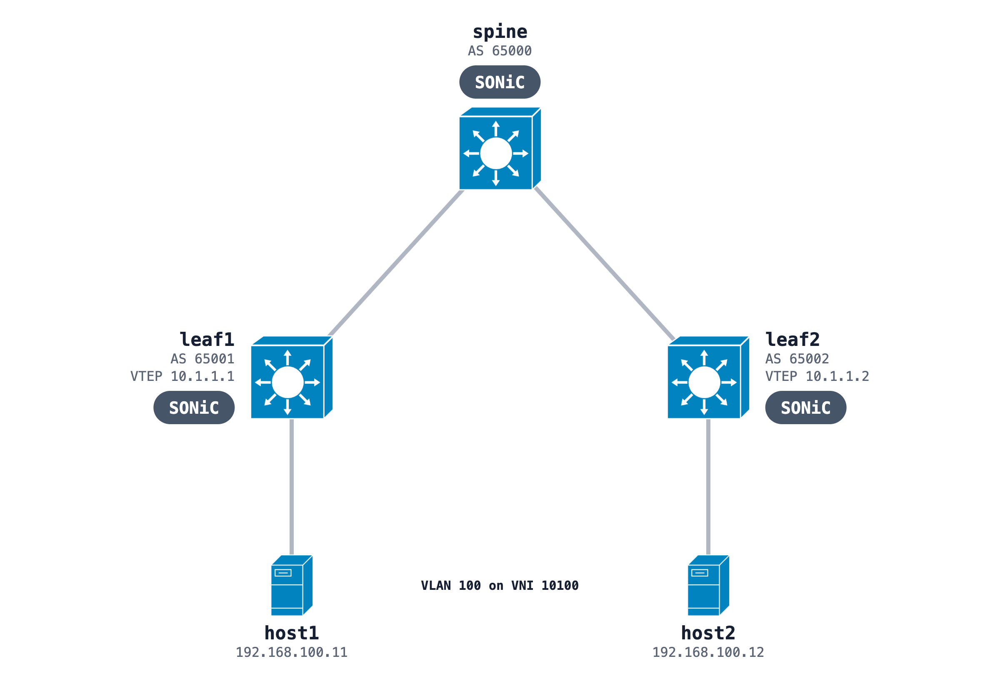

# SONiC EVPN-VXLAN with an L2 VNI

One spine and two leaves with an eBGP underlay and a BGP EVPN overlay. VLAN 100 on each leaf maps to VNI 10100, so the two hosts share one subnet across the fabric. Each switch configures itself at deploy from its script in `configs/`.



## Run it

```bash
sudo containerlab deploy -t evpn-l2vni.clab.yml
docker exec clab-sonic-evpn-host1 ping -c 3 192.168.100.12
docker exec clab-sonic-evpn-leaf1 show vxlan remotemac all
docker exec clab-sonic-evpn-leaf1 vtysh -c 'show bgp l2vpn evpn route type macip'
```

After the ping, leaf1 lists host2's MAC behind remote VTEP 10.1.1.2, learned from the type-2 route. The image and memory notes are in the [SONiC README](../README.md).

## Build it from one prompt

[The prompt](https://github.com/netpilot-labs/example-prompts/blob/main/data-center/sonic-evpn-vxlan-l2vni.md) builds the same fabric in [NetPilot](https://www.netpilot.io/sonic-nos-lab) and runs the verification command after each step.

## Tutorial

[Learn VXLAN EVPN on SONiC](https://www.netpilot.io/solutions/learn-vxlan-evpn-sonic)
